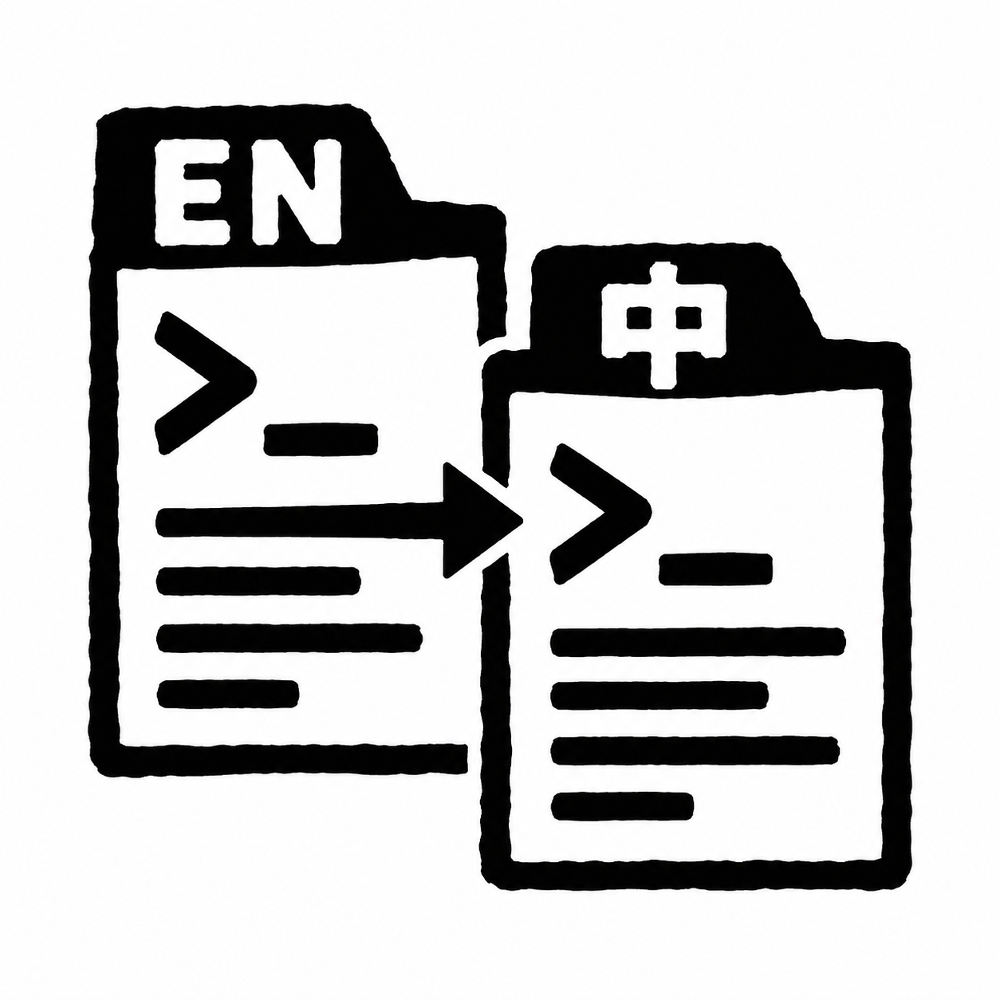

# skills

我创建的skills && 我使用的skills。

## 目录

- [我创建的 skills](#我创建的-skills)
  - [总览](#总览)
  - [使用示例](#使用示例)
- [我使用的第三方 skills](#我使用的第三方-skills)

## 我创建的 skills

### 总览

|                                                                                        名称                                                                                         | 用途                                                                       |
| :---------------------------------------------------------------------------------------------------------------------------------------------------------------------------------: | :------------------------------------------------------------------------- |
|  <br>**[tldr-en-page-maintainer](tldr-en-page-maintainer/SKILL.md)**  | 创建、更新和润色英文 [tldr](https://github.com/tldr-pages/tldr) 页面。     |
| <br>**[tldr-zh-page-maintainer](tldr-zh-page-maintainer/SKILL.md)** | 翻译、同步和润色简体中文 [tldr](https://github.com/tldr-pages/tldr) 页面。 |
|                 <br>**[image-generator](image-generator/SKILL.md)**                 | 生成、编辑和批量生成图片。                                                 |
|                     <br>**[visual-summarizer](visual-summarizer/SKILL.md)**                     | 生成指定内容的概括性图片。                                                 |
|               <br>**[musescore-snapper](musescore-snapper/SKILL.md)**               | 搜索曲谱并逐页截图保存 PNG。                                               |

### 使用示例

```text
$tldr-en-page-maintainer 更新 rg 的英文页面。
$tldr-zh-page-maintainer 同步 rg 的中文页面，与英文版保持一致。
$image-generator 画一张钢琴主题的手机壁纸。
$visual-summarizer 给 musescore-snapper/ 生成一张概括图。
$musescore-snapper 帮我找《Fly Me To the Moon》的钢琴谱，截图保存到 ~/Music/Scores。
```

## 我使用的第三方 skills

### 前端开发与设计

- [frontend-skill](https://developers.openai.com/blog/designing-delightful-frontends-with-gpt-5-4)
- [vercel-react-best-practices](https://github.com/vercel-labs/agent-skills/tree/main/skills/react-best-practices)
- [vercel-composition-patterns](https://github.com/vercel-labs/agent-skills/tree/main/skills/composition-patterns)
- [web-design-guidelines](https://github.com/vercel-labs/agent-skills/tree/main/skills/web-design-guidelines)

### 浏览器自动化与测试

- [playwright](https://github.com/openai/skills/tree/main/skills/.curated/playwright)
- [playwright-interactive](https://github.com/openai/skills/tree/main/skills/.curated/playwright-interactive)

### 文档处理

- [tencent-docs](https://docs.qq.com/scenario/open-claw.html)
- [image-to-editable-ppt](https://github.com/ningzimu/image-to-editable-ppt-skill/tree/main/skills/image-to-editable-ppt)

### 需求梳理与方案讨论

- [grill-me](https://github.com/mattpocock/skills/tree/main/skills/productivity/grill-me)
